# monet

monet is a Claude Code plugin for the work that starts once Claude has written the code: reviewing the change, then turning it into a commit and a pull request. After you install it, make a change and type `/monet:review-local` for a read-only review before you push. When the change is ready, `/monet:ship` drafts the commit and the PR, then commits, pushes, and opens the PR once you say yes.

## How it works

Claude writes the change. monet takes it from there: it reviews the change, ships it as a commit and a PR that read like you wrote them, and helps you understand what landed.

<picture>
  <source media="(prefers-color-scheme: dark)" srcset="docs/assets/how-it-works-dark.svg">
  
</picture>

## Install

Run these two commands in Claude Code:

```
/plugin marketplace add initor/monet
/plugin install monet@monet
```

You need a Claude Code version with plugin support. Some skills need extra tools, and their `SKILL.md` names them (for example, gang: Go, Node, and `gh`).

## First run

Start a new session in a repo after the install. Build a change with Claude, then walk the loop in the diagram:

- `/monet:review-local`: reviews your uncommitted or branch changes, and draws the findings as a page.
- `/monet:ship`: drafts the commit and the PR, asks you once, and then commits, pushes, and opens the PR.
- `/monet:help`: lists every monet command. To ask in plain words instead, start a session with `claude --agent monet:monet`, and it picks the skill.

Beyond the loop:

| You want to | Type |
| --- | --- |
| Review a teammate's pull request | `/monet:pr <url>` |
| Turn findings into a page you can share | `/monet:paint` |
| Make a draft sound like you | `/monet:voice` |
| Land a whole plan with a fleet of agents | `/monet:gang plan <spec-dir>` |
| Pick the work up in a fresh session | `/monet:handoff` |

## Skills

Type a skill as `/monet:<name>`, or ask in plain words and let Claude pick it. A skill shown as `monet:<name>` is not a slash command, and other skills load it.

<!-- BEGIN GENERATED:skills -->

| Skill | What it does |
| --- | --- |
| `/monet:cwd-context` | Use when a session or skill needs to know whether the current working directory is a git codebase or a non-git workspace (defaults to operation). |
| `/monet:distill-voice` | Use when the user hands you a piece of writing, or names a corpus of their own, and wants its mechanics extracted into a named persona that the voice skill can apply. |
| `/monet:gang` | Use when the user asks to "orchestrate" a build, says "run this plan with a fleet", or wants a "fleet" or "gang" of agents to turn specs into a task graph and land every task on main through wave PRs. |
| `/monet:git-changes` | Use when drafting a commit or PR, or asked "what changed?". |
| `/monet:git-draft-commit` | Use when the user asks to draft a commit message for the current uncommitted changes. |
| `/monet:git-draft-pr` | Use when the user asks to draft a pull request or write a PR description for the current branch's changes. |
| `/monet:hairline-create` | Use when someone asks for a new Hairline figure, or runs /monet:hairline-create with an idea. |
| `/monet:handoff` | Use when the user is running out of context and needs to continue in a fresh session ("I'm at 80% context", "I have to start a new session", "draft me a prompt to pick up this work", "hand this off"). |
| `/monet:help` | Use when the user asks what monet can do, which /monet commands exist, or how to invoke a monet skill ("monet help", "list monet commands"). |
| `/monet:new-skill` | Use when the user asks to create, scaffold, or add a new monet skill ("new monet skill", "scaffold a skill for X"). |
| `/monet:paint` | Use when the user asks to visualize, "paint", or turn session research/analysis/data into a shareable self-contained HTML page, or wants a visual summary of findings. |
| `/monet:pr` | Use when a GitHub PR URL is shared and the user asks to review a pull request or do a code review on it before merge. |
| `/monet:review-code` | Use when the user asks to review a Go repository, including Kubernetes code, against official conventions (Effective Go, Go Code Review Comments, K8s best practices). |
| `/monet:review-local` | Use when the user wants to review uncommitted or branch changes before opening a PR ("review my changes", "check before I push", "pre-PR review"). |
| `/monet:roadmap` | Use when the user asks to refresh, regenerate, or update a work stream's roadmap page, says "refresh the roadmap", or asks for a roadmap.html for a stream. |
| `/monet:ship` | Use when the user wants to commit and open a PR in one step (asks to "ship", "land", "open a PR", or push-and-PR the current branch's uncommitted changes or commits ahead of main), or asks to "make a commit", which takes the commit-only path. |
| `/monet:status` | Use when the user wants to inspect what monet can do or how it is wired ("monet status", "which skills does monet have", "show the monet agent config"). |
| `/monet:teach` | Use when the user wants to deeply understand the work that was just done, or a target they name (a PR, a file or diff, a concept), through an incremental teaching loop: a running understanding checklist, restate-then-fill-gaps, eli5/eli14/intern explanations, and quizzing that doesn't stop until they've demonstrated mastery. |
| `/monet:think` | Use when the user types /monet:think to make a task more ambitious ("be more ambitious", "think higher, deeper or wider", "an out-of-the-box take on X"). |
| `/monet:visual-design` | Use when designing something visual that the owner picks by eye, such as a logo or mark, a figure, the look of a page, or an HTML overview like a system architecture page, worked out over rounds of options. |
| `/monet:voice` | Use when prose will go out under the user's name and must not read as generated (PR descriptions, review replies, commit bodies, design docs, Slack, peer feedback), or when asked whether a draft sounds like the user. |
| `/monet:web-operator` | Use when the user wants their authenticated Chrome driven to read or operate Slack, Google Docs, dashboards, and other web UIs in dedicated tabs, through Claude-in-Chrome. |

<!-- END GENERATED:skills -->

## Configuration

monet has two settings in `.claude-plugin/plugin.json`:

| Key | Default | What it sets |
| --- | --- | --- |
| `branch_prefix` | empty, so no prefix | The text in front of each branch name that monet makes, so a branch is `<prefix><slug>`. |
| `data_dir` | `~/.config/monet` | The dir that holds your own data, such as voice personas. |

Set them in one of these ways:

```
/plugin configure monet@monet
claude plugin configure monet@monet
claude plugin install monet@monet --config data_dir=<path>
```

An unset key stays as the literal placeholder text, even though `plugin.json` gives it a `default`. So each skill falls back to the default itself. It uses no prefix for `branch_prefix`, and it uses `~/.config/monet` for `data_dir`.

## Update and uninstall

To update, run this command:

```
claude plugin update monet@monet
```

Then restart Claude Code, or run `/reload-plugins`, to load the new version.

To uninstall, run this command:

```
claude plugin uninstall monet@monet
```

Uninstall keeps your data dir. Your personas stay there until you remove them.

## Docs

- [Development](docs/development.md): the dev loop, `make check`, CI, and a release.
- [Authoring a skill](docs/authoring.md): add or change a skill in the plugin layout.
- [Architecture](docs/architecture.md): how the skills, the agent, the output style, and the data dir fit together.
- [Gang design](docs/design/gang.md): how the gang skill runs a plan with a fleet of agents.
- [Roadmap and handoff design](docs/design/roadmap-handoff.md): the roadmap and handoff skills.
- [Contributing](CONTRIBUTING.md): the rules for a pull request.
- [Changelog](CHANGELOG.md): what each release changed.

## Credits

- `/monet:gang` is inspired by [pstack](https://github.com/cursor/plugins/tree/main/pstack), from Cursor's plugins repo. Gang takes its core method from pstack: the brief is the product, a ledger is keyed by commit SHA, each round gets a fresh agent, and an independent reviewer checks every result.
- `/monet:hairline-create` is a copy of the skill from [Hairline](https://github.com/lucasmarkes/hairline), under its MIT license. Its `UPSTREAM.md` lists the local changes.
