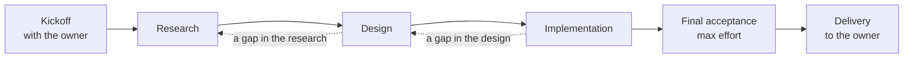
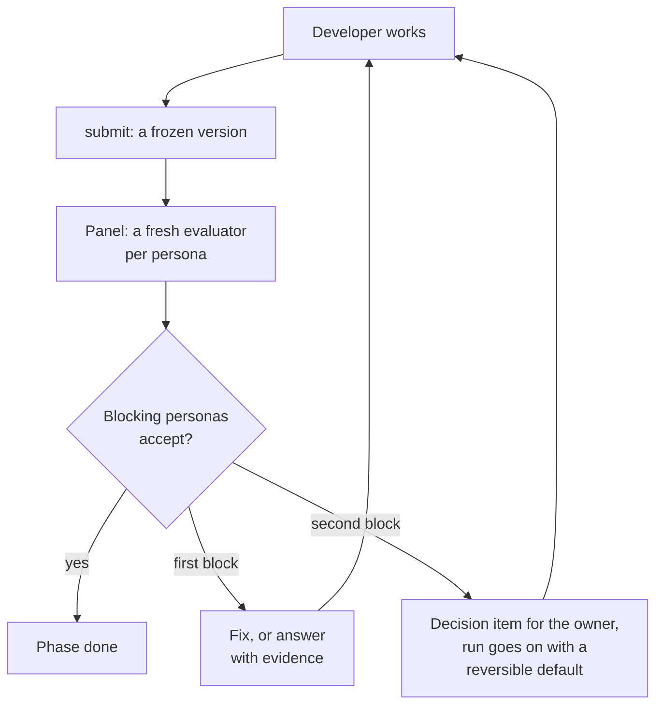

# Design: `monet:source`, the Brain above gang

Date: 2026-11-01. Status: draft. The builder check is done, its four questions became D29 to D32, and the owner reviews this document next. Section 3 cites monet at 73c7248. The decisions call the orchestrator role the Brain, and so does this document. The skill is `monet:source`, and its engine is the Go binary `monet-source` (D28).

## 1. Intent

The owner does large infrastructure work in a fixed rhythm: research, then a design with a risk check, then a prototype. An outside reviewer checks each step. Today the owner must drive that loop. A run that would "keep me in the loop" is a red flag, in the owner's words (D3).

- **Autonomy.** After one kickoff, a run works for hours, or for more than 24 hours, with no one. It comes back only at a rare wall (D3, D17).
- **An outside eye.** The agents that build get tunnel vision. A fresh evaluator with a strong persona steers them in every phase (D4, D5).
- **A polished result.** The bar is what a seasoned infrastructure engineer delivers, not a bare minimum (D6).
- **gang stays the executor.** `monet:source` is a new skill above `monet:gang`, and in step 2 it uses gang to land code (D1, D10, D29).

## 2. Goals, non-goals, and anti-goals

Goals:

1. One kickoff with the owner seals a charter. Then the run needs no one until delivery, except at a wall.
2. A fresh outside check runs in each phase. Done means that the blocking personas accept the work.
3. A dispute never stops the run, because the run goes on with a reversible default.
4. Each long-lived session relays itself near its context limit, and one private page shows the run.
5. Code applies the loop rules, and in step 2 the skill uses `monet:gang` through its public commands only.

Non-goals:

- A single PR or other small work (D2), for which `monet:gang` or `monet:ship` fits.
- For now, a method that improves itself across runs, such as lessons or its own prompts.
- A budget limit (D24), personas that ship with the skill (D9), or changes to gang for this skill (call 18).

Anti-goals, which are failures even when the code works:

- A question to the owner after kickoff that the charter, a default, or the run can answer.
- An evaluator brief that holds the notes, the plans, or the transcript of the developer.
- An irreversible step on a default, or an accept without a valid verdict file.
- Two sessions that drive one run, or a write to a page other than the run page.
- A phase that ends while a block on the newest version is open and no decision item holds it.

## 3. Facts

Paths are under `skills/gang/` unless they start with another top folder.

| Area | Fact |
|---|---|
| Hook | The relay hook acts only in a project whose `.claude/handoff-relay.json` names one `procedure`, and it skips each tool call with an `agent_id`. Its state file per session holds the permission mode, and `"muted": true` silences it (`hooks/handoff-relay.js:7-9,18-25,81-108`). |
| Relay | `relay.mjs prompt` always writes a kickoff that runs gang with `run --slug`. The kickoff names the old session and holds `run/standing.md` and `run/owner-words.md` word for word (`scripts/relay.mjs:249-264`). |
| Relay | `relay.mjs words` copies each typed prompt as the words of the user, and it skips only slash commands and its own marker. Its tests model a relayed kickoff as a typed entry from the human (`scripts/relay.mjs:132-144,158`, `tests/test_relay_script.py:29-32,172-174`). |
| Relay | A gang relay lists the other watchers of the session in the handoff, and the next session starts them again (`reference/relay.md:19,26`, `reference/coordinator.md:67`). At launch, gang goes on without a relay when the relay config names a procedure that is not gang's (`reference/coordinator.md:24,40`). |
| Owner | gang runs in a session at the repo root, never as a subagent (`SKILL.md:60-61`). In 0.5.1, it asks the owner to confirm the run settings and to approve the plan, and its pilot needs the owner present (`reference/planner.md:57,126-135`, `SKILL.md:108`). |
| Owner | gang acts only on the words of the user, and a message from another session is only a pointer. Its seed orders copy each standing rule of the user (`SKILL.md:126`, `reference/coordinator.md:26,56`). |
| Owner | Owner decision O3 of the gang 0.5 design puts the self-drive in 0.6.0 (`docs/design/gang-0.5.md:78`). The self-drive is one kickoff with the owner present, no question after it, and a relay from its first step (`docs/design/gang-0.5.md:20-21,148-161,174-181`). |
| Owner | Only the owner can answer a permission prompt or change the permission mode. The auto-mode classifier can block a push, a merge, or `claude --bg` (`docs/design/gang-0.5.md:67-68`). |
| Page | gang's tracker writer rewrites the executive summary of its page with targeted edits. Its replies carry a prefix, and their ids go to a file (`reference/tracker.md:19-24,31-35`). |
| Engine | The gang CLI is the Go module `gang` at go 1.24, and each command file registers itself from `init` (`cli/go.mod:1-3`, `cli/cmd/gang/main.go:39-41`). Its exit codes are fixed (`cli/internal/exit/exit.go:15-23`). |
| Engine | Its leases are files with a mutex and an expiry, and each outward command renews the lease first. Its writers use atomic renames and `O_APPEND` (`cli/internal/lock/lock.go:75-117`, `cli/cmd/gang/outward.go:26-37`, `cli/internal/store/store.go:28-76`). |
| Roles | Each gang role has its own model and effort, and 9 of the 11 roles use `high` or `xhigh` (`roles.json:1-13`). |
| Tests | `cli/internal/testkit` makes temp repos with no user git config, for `_test.go` files only (`cli/internal/testkit/testkit.go:1,34-61`). No tracked file holds a mutant runner: `git grep -i overlay` finds nothing at 73c7248. |
| Gate | `make check` runs prereqs, manifest, catalog, unittest, scan, and lint, and `make test` adds `tools/test-gang.sh`. CI runs `make test` with Go 1.24 (`Makefile:30,97-111`, `.github/workflows/check.yml:22-27`). The lint checks the frontmatter, the description, the skill paths, and the agent routes (`tools/check_skills.py:10-25`). The scan fails on an em-dash in Markdown, an email, a private term, or a dotfiles path (`tools/scan.py:15-25`). |
| Repo | The Run scratch sentence names six skills, and a test allows six skill names per sentence at most (`docs/architecture.md:86`, `tools/tests/test_doc_architecture.py:32,188-191`). A skill never reads another skill's `SKILL.md` by path (`docs/architecture.md:34`). A typed-only skill sets `disable-model-invocation: true` (`skills/think/SKILL.md:6`). The plugin is at 0.5.1 (`.claude-plugin/plugin.json:3`). The minor release 0.3.0 added the new skill `/monet:think` (`CHANGELOG.md:45-49`). |

## 4. Decisions of the owner

The owner made these decisions on 2026-10-31 and 2026-11-01. This text writes "the owner" in place of a name, and neutral examples in place of project names. The last column names the section that applies each one.

| # | Decision | In |
|---|---|---|
| D1 | The Brain is a new skill. It does not add features to `monet:gang`, which stays the executor. | 1, 5.11 |
| D2 | Use the Brain only for large work: research with a proposal and a design doc, a demo, or a report. The kickoff sets the form of the deliverable for each use case. A single PR does not need the Brain. | 5.2 |
| D3 | A run takes hours or more than 24 hours, and it must be autonomous. A run that keeps the owner in the loop is a red flag. Autonomy is the main reason to build the skill. | 1, 5.6 |
| D4 | The evaluator gives a fresh view with a strong persona. Its feedback steers the direction and corrects the tunnel vision of the agents that do the work. | 5.4 |
| D5 | The evaluator works through the full run: research, design, and implementation. It is not one gate at the end. | 5.3 |
| D6 | The quality bar is "relatively polished": the work that a seasoned infrastructure engineer delivers, not a bare minimum. This bar is what "self-improvement" means here. | 5.2 |
| D7 | The Brain decides when the work is done: the evaluator must accept that the work meets the quality bar. The owner sees the result at delivery. | 5.4 |
| D8 | The evaluator is truly outside. It starts with a fresh context and gets only the goal and the artifacts, not the reasoning of the developer. The developer does not choose the evaluator and does not write its brief. | 5.4 |
| D9 | The owner gives the personas at each kickoff, for each project. The skill hard-codes no persona. An earlier example only shows the idea: a domain expert, an insider of the current platform, and an end user of the platform. The insider knows what exists today and checks if a design is feasible, for example the migration cost. The end user is a minor input, and asks if the daily flow gets better. | 5.2 |
| D10 | An upstream skill may depend on a downstream skill, and a downstream skill never depends on an upstream skill. So `monet:source` may use `monet:gang`, and gang never depends on source. This boundary makes later extensions easy. The Brain uses gang only when the deliverable includes code to land on main. The parts that both skills need live in a shared monet layer. | 5.9, 5.10 |
| D11 | The kickoff session becomes the Brain session, the main session of the run. It talks with the owner only at the kickoff. After that, it orchestrates and does not do the work, so its evaluator briefs do not carry the reasoning of the developer (D8). The developer runs in its own background session. Each evaluator check is a fresh subagent that the Brain briefs. | 5.1 |
| D12 | Every long-lived session relays itself to a new background session near its context limit, and the Brain session does too. The owner named this as the one concern about D11. The relay of gang does this for its coordinator, so the Brain uses the same pattern. | 5.8 |
| D13 | The evaluator panel follows five rules. | 5.4 |
| D14 | Each persona is a kickoff parameter, not a part of the skill. The owner gives each persona as a card: the description, the weight (blocking or advisory), and the sources to read. It can also name the phases to check, and without them the Brain picks. The description can be long and carry context and expectations. | 5.2 |
| D15 | At the kickoff, the owner gives the context, the expectations, the invariants that are already decided, and the eventual goal. The Brain asks clarification questions to make these clear. The kickoff does not decide everything. | 5.2 |
| D16 | The kickoff works by five points. | 5.2 |
| D17 | The Brain comes back to the owner only at a wall that only the owner can clear. One example is a point that the design missed and the implementation finds. The owner expects this to be rare, and it is acceptable. The flow of the Brain never expects the owner in the loop. | 5.6 |
| D18 | The escalation rules for D17 have six points. | 5.6 |
| D19 | At a wall, the Brain tells the owner in the Brain session or on the private Notion page of the run. The owner gives this page at each kickoff, and it is the channel between the owner and the Brain. | 5.6 |
| D20 | When the developer and a persona disagree, the owner decides, and the run does not wait for the owner. Six rules apply. | 5.5 |
| D21 | The agents of a run use medium effort by default, and the Brain uses max effort only in special cases. A round has no fixed length. | 5.3 |
| D22 | The owner confirmed the loop shape: six points and two diagrams. | 5.3 |
| D23 | The back-and-forth with one persona has a hard cap of 2. When the same persona blocks twice, the Brain escalates to the owner (D20). Four details apply. | 5.5 |
| D24 | A run has no budget limit for now. Done (D7), the cap (D23), and walls (D18) are enough. | 5.6 |
| D25 | The reporter and the page work by six points. | 5.7 |
| D26 | The Brain has its own deterministic engine: a CLI with its state on disk, not orchestration that an LLM runs. It is in a compiled language, for speed, compile-time checks, and testability, and Go is the first choice. It does not depend on the engine of gang, so the two skills can change on their own. The Brain still uses gang as a tool (D10). | 5.9 |
| D27 | The engine is in Go, because Rust gains less here than it costs. The Brain imports no code of gang and calls only its public commands. It keeps its own lease and state. Only plugin-wide parts are shared, such as the relay hook. | 5.9, 5.10 |
| D28 | The skill is `monet:source`, after the Source in The Matrix. Its binary is `monet-source`, because `source` is a shell builtin in bash and zsh. The owner chose the name, and Claude chose the binary name. | 5.9 |
| D29 | The skill ships in two steps. The first step has no implementation phase: research, design, and report runs, which need no `monet:gang`. The second step adds the implementation phase after the self-drive of gang ships. | 5.10, 5.13 |
| D30 | A kickoff grant in the words of the owner lets the developer derive the run settings of gang from the repo. It also lets the developer confirm a dead session with `claude agents`. Each such answer is a run decision on the run page. A setting that the developer cannot derive is a wall. | 5.2, 5.10 |
| D31 | A kickoff grant in the words of the owner covers the entries that the Brain copies word for word into `<run>/owner-words.md`. These entries count as words of the owner in the gang run of the developer. This keeps the one channel of D19. | 5.6, 5.10 |
| D32 | Each charter says if main deploys. By default, main does not deploy: a merge is reversible through a revert PR, so gang keeps shipping on a default. When main deploys, a merge is irreversible, and tasks that depend on an open decision item stay out of the PR queue. | 5.2, 5.5, 5.10 |

## 5. Design

### 5.1 Parts and sessions

| Part | What it is | Writes |
|---|---|---|
| Brain session | The kickoff session (D11). After the kickoff, it runs the engine, starts the checks, and reads the channel. | Run state, through the engine |
| Developer | A background session in its own folder (D11). It does the research and the design. In step 2, it also does the build and lands code through gang (D10). | Versions, answers to findings, and run decisions |
| Evaluator | A fresh subagent of the Brain session for each check of one persona (D11, D13) | One verdict file |
| Reporter | A fresh subagent of the Brain session for each page update (D25) | The run page |
| Engine | The Go binary `monet-source`, built into the run folder (D26 to D28) | All run state on disk |
| Run page | The private Notion page that the owner gives at the kickoff (D19) | Nothing, because it is the channel |

D11 says that the Brain session talks with the owner only at the kickoff. Walls (D17 to D19), decision items (D20), and delivery (D7) are the only exceptions.

Each session starts in its own folder, so each one has its own `.claude/handoff-relay.json` (call 1). The Brain session runs in `<home>`, the folder where the owner starts the kickoff, and `<run>` is `<home>/.planning/source/<slug>/`. The developer runs in `<run>/dev/`. When code lands on main (step 2), `<run>/dev/` is a linked worktree of the target repo, because gang runs only at a repo root. The pilot proves that the developer session reads its own relay config. When `<home>` is a repo, the local exclude file keeps `<run>` and the relay config out of git (call 2).

### 5.2 Kickoff

The owner types `/monet:source kickoff [<file>] [--slug <slug>]`. The owner gives the context, the expectations, the invariants already decided, the eventual goal, the persona cards, and the run page (D15, D19).

1. **Questions.** The Brain asks one question at a time, only when the answer changes the direction (D16 point 2). A question that needs research goes to the run.
2. **Charter.** The Brain writes `charter.json`, and `charter lint` checks it. The owner confirms `charter.md`, and `charter seal` records those words (D16 point 1).
3. **Preflight.** `preflight` checks each item below. The Brain asks the owner only about the items that fail, in one list (D18, call 3).
4. **Pilot.** The Brain starts the developer while the owner is present. The developer makes one harmless call per tool that it needs.

The run starts after the seal, a clean preflight, and a clean pilot. The charter holds `goal` and `context` (D15), `invariants` with ids (D16), `deliverable` (D2), `phases` (D22), `quality_bar` (D6), `personas` (D14), and `page` (D19). Its `grants` list each outward step that the charter covers, with the id of the words that grant it (D18). Step 1 has no demo runs, because a demo needs the implementation phase (D29). In step 1, `charter lint` refuses a charter whose `phases` hold `implementation`, or that has `repo` (call 24).

In step 2, the charter also holds `repo` when code lands on main, and `main_deploys`, which is `false` by default (D32). With `repo`, the Brain asks about `main_deploys` with the workflows that run on a push to the base branch in view (call 26). The `grants` then also hold each gang answer that the charter covers: the grants of call 15, D30, and D31 (5.10).

A persona card holds `id`, `description`, `weight` (`blocking` or `advisory`), `sources`, and optional `phases` (D14). The skill ships no card (D9), and `charter lint` refuses a charter with no blocking persona (call 4). After the seal, the Brain expands each description into a full brief, once per persona (D13). The engine stores each brief with its hash, so every check of one persona reads the same brief.

D16 points 3 to 5, which the owner confirmed:

- The run decides everything outside the charter. The developer decides, the evaluator steers, and each decision goes on the page with its reason.
- An invariant is a hard constraint, and nobody in the run changes it. When it only costs much, the Brain keeps it, continues, and shows the cost on the page and at delivery. An invariant that cannot work at all is a wall (5.6).
- Each evaluator brief includes the charter. The evaluator judges against the eventual goal and the quality bar, not against the reading of the developer.

The preflight covers what D18 names. The tools are `go` 1.24 or later, `node` 22 or later, `git`, `claude`, `gh`, and Docker when the gate needs it (step 2). The credentials are `gh auth status` and a fetch of the page and of each source. The permissions are allow rules in both folders for `claude --bg`, `claude agents`, the engine, and gang (step 2), in accept-edits mode as gang asks. The power check reads `pmset -g batt` and `ioreg -r -k AppleClamshellState`. The relay config of `<home>` must be absent or name this run, and the Brain posts `[source <slug>] Page ready.` on the page.

### 5.3 The loop

The run moves through the phases of the charter, then a final acceptance check, then delivery (D22, call 5):



D22, the loop shape that the owner confirmed:

- A run moves through research, design, and implementation, and then it delivers. A later phase can send work back to an earlier phase when it finds a gap.
- Each phase runs rounds. In a round, the developer makes a new version of the artifact, and the evaluator panel checks it. The phase ends when the blocking personas accept the artifact.
- After each round, the reporter updates the page, and the Brain checks its own context for a relay.
- In the implementation phase, the developer uses `monet:gang` to land code on main (D10).
- Max effort (D21) goes to the last acceptance check and to the second check of a persona that blocked once (D23).
- A run uses only the phases that its deliverable needs. For example, a run for research and a proposal has no implementation phase.

In step 1, a run has no implementation phase and uses no gang (D29). In both steps, the panel checks each phase, and it is not one gate at the end (D5). In one round, the developer runs `submit`, and the Brain runs `round open`. The Brain sends one Agent call per check, all in one message, and each evaluator writes its verdict file. Then the Brain runs `round close`, sends the reporter, and runs `context`.



A version is frozen. For documents, `submit --path` copies the files into `<run>/artifacts/<phase>/v<k>/` with a manifest of hashes. For code (step 2), `submit --sha` records the SHA, and the engine writes a `git archive` of it there. A verdict holds for one version, and a new version voids it, as in gang (`skills/gang/SKILL.md:100`). So the last round of a phase checks every blocking persona of that phase.

The developer, each evaluator, and the reporter start at medium effort (D21). The engine gives max effort only to a second check and to the final acceptance check. A round has no fixed length, so the engine sets no round timeout. The Brain session keeps the effort that the owner started it with (call 6).

### 5.4 The evaluator panel and acceptance

The evaluator gives a fresh view with a strong persona, and its findings steer the developer (D4). The panel follows the five rules of D13:

- Each persona reviews alone and does not see the other reviews. The Brain merges the reviews.
- Each persona has a weight. A blocking persona can stop "done", and an advisory persona only gives input.
- The owner describes each persona at the kickoff (D14). The Brain, not the developer, expands each description into a full brief.
- Each persona reads the sources that its role needs, read-only. Examples are internal repos and pages for an insider, or upstream docs for an expert.
- The Brain picks the personas that are relevant to each phase. Not every persona checks every round.

The engine builds each evaluator brief from an allowlist (D8, D16 point 5). The brief holds the charter, the persona brief, the paths of the version, the verdict path, and the verdict schema. A second check also gets the blocker findings of its persona and the `response.md` of the developer for them (5.5). The developer keeps its notes in `<run>/notes/`, which no brief names, and its plans and transcript never enter a brief. `round.json` keeps the hash of each brief. So the second check of D20 sees the answer of the developer, but never its reasoning (call 7).

A verdict is one JSON file with the persona, the check id, `accept` or `block`, and the findings. Each finding has an id, a severity (`blocker`, `major`, or `minor`), the problem, the evidence, and the ask. A `block` needs at least one `blocker`, and a missing, invalid, or reused verdict is never an accept (call 8).

`round close` opens a decision item for each second block (5.5). It gives `ACCEPT` when each blocking persona in the panel of the phase accepts this version, or an item holds its block (D7, D13). Otherwise it gives `FIX`. Advisory findings and the findings of an accept are input, which the developer fixes or declines with a reason. The engine merges the findings by persona into `findings.md`. The Brain may add a note that groups duplicates, but it never drops or edits a finding (call 9).

Done (D7) needs the final acceptance check after the last phase. In it, each blocking persona that checks the last phase reviews the whole deliverable at max effort. When each one accepts, the run delivers (5.6).

### 5.5 Disagreements, the cap, and decision items

D20, the rules that the owner confirmed:

- First, the two sides argue it out. The developer answers each finding with a fix or with evidence, and a fresh evaluator with the same persona judges that evidence.
- Only a disagreement with a blocking persona that survives this step goes to the owner. The developer may decline advisory input and records the reason.
- The Brain writes the decision item on the page. It holds both positions, the evidence, the default that the Brain recommends, and the work that the choice affects.
- The run does not wait for the owner. It continues on the default, which must be reversible, and marks the work that depends on the choice.
- If the owner rules against the default, the run goes back to that point and builds the other way.
- A disputed choice that is irreversible, or that blocks all work, is a wall (D18).

D23, the details of the cap of 2 that the owner confirmed:

- The count is per persona and per phase. It resets when the phase ends or when the owner rules.
- The first block starts the D20 steps. The second check by a fresh evaluator with the same persona decides, and a second block escalates.
- The run goes on with a reversible default while the owner decides (D20).
- The second check runs at max effort, because it decides the escalation.

D23 bounds the first rule of D20. After a first block, the developer answers each finding with `respond`: fixed, evidence, or declined. The next round checks that persona again at max effort, with its findings and the answer. A second block makes the engine open a decision item, and the Brain adds the default, the way back, and the affected work. The engine refuses an item with no way back. When the choice is irreversible, or the dispute blocks all work, the Brain opens a wall instead.

After an escalation, the persona keeps checking later rounds of the phase, and each further block opens a decision item at once (call 10). A phase can end while decision items are open, and the page and the delivery list them (D25). The Brain records a ruling with `item rule <id> --pick <option> --words <id>`, which resets the count of that persona. If the pick is not the default, the engine sends the run back to the phase of the item, and the developer gets `RULING`. A ruling after delivery needs `/monet:source resume`, which reopens that phase (call 11).

In step 2, while main does not deploy, the way back of a default that merges code is a revert PR (D32). So gang keeps shipping on a default, and a ruling against it brings the revert PR and the rework. When the charter says that main deploys, a merge is irreversible. Each task that depends on an open item then stays out of the PR queue until the owner rules, and other work goes on. When those tasks are all the work that is left, the item blocks all work, and the developer opens a wall (D20). In code (D26), the engine keeps the tasks that `item hold` names, and the page packet and the `RULING` event list them with the item.

### 5.6 Walls, the channel, and done

The flow never expects the owner, and a wall should be rare (D3, D17). D18, the escalation rules that the owner agreed to:

- A wall is a blocker that only the owner can clear. Examples are an invariant that cannot work at all and a missing credential or permission. Another example is an outward or irreversible step that the charter does not cover.
- Proof that an invariant cannot work is a valid result of the run, not a failure. The Brain brings the evidence to the owner.
- At a wall, the Brain parks only the blocked work and continues the rest. It asks the owner one short question that names its default and what the wall blocks.
- The Brain never takes an irreversible step on its own default.
- The kickoff ends with a preflight that makes walls rare (5.2).
- The owner states the invariants with care at the kickoff, as a part of the goal.

D16 point 4 and D18 fit in this way. An invariant that only costs much stays, and the page shows the cost. An invariant that cannot work at all is a wall. At that wall, the owner can amend the invariant with `charter amend`, which needs new words of the owner. Or the owner can accept the proof as the result of the run.

The channel of D19 follows the channel details of the decision log (call 12):

- The Brain writes a wall in the Blockers line of the executive summary and sends one message in the Brain session.
- The owner can answer in the session or in a comment on the page. The Brain reads both at each round.
- After a relay, the first Brain session forwards the messages of the owner to the live session, as the relay of gang does (`skills/gang/reference/relay.md:41-48`).
- The Brain writes only to that one page.

A live session that is not the kickoff session also sends each wall message to the kickoff session, which shows it to the owner. The comment rules of gang's tracker apply (`skills/gang/reference/tracker.md:19-24`). Only the comments of the owner count, each reply starts with `[source <slug>]`, and the Brain never resolves a discussion. `relay words` copies each message that the owner typed into `<run>/owner-words.md`, as gang does. A page comment that the Brain acts on goes there too. A seal, a grant, an amend, a ruling, and a wall clear each name the id of an entry.

In step 2, a wall can come from the gang run of the developer, and the owner answers it through this channel too (D31). The Brain copies the answer word for word into `<run>/owner-words.md`, and the `CLEARED` or `RULING` event carries its entry id, not its words. The rule of gang names only its own `owner-words.md` (`skills/gang/SKILL.md:126`). The grant of D31, which the kickoff prompt carries word for word (5.10), makes gang count the entry as the words of the owner. As with a pointer from another session, the developer reads the entry and acts on it as on a message from the owner (`skills/gang/reference/coordinator.md:26`). So the owner never types into the developer session, and D19 keeps one channel.

D24 sets no budget, so done (D7), the cap (D23), and walls (D18) bound a run. `deliver` checks done: each phase of the charter ended, and the final acceptance check accepted. Open decision items do not stop delivery. The reporter writes the delivery to the page, and the Brain sends one message with the link. Then the Brain stops the developer and releases both leases.

### 5.7 The reporter and the page

D25, the points that the owner confirmed:

- The page has a fixed order. The executive summary comes first, then the items that wait for the owner, the decisions, and a dated log.
- The executive summary says what the run builds, where it is, what comes next, what blocks it, and when it changed last. It holds the architecture diagram of the deliverable.
- The items that wait for the owner are the walls (D18) and the decision items (D20), each with its default.
- The reporter is a fresh subagent that reads the run state and writes the page. It writes after each round and at least once an hour.
- At delivery, the page links the deliverable. It lists the verdicts of the evaluators, the costs of invariants (D16), and the decisions that still wait for the owner.
- The page is in English and follows STE-lite.

The engine makes the content, and the reporter writes it. `report` prints a packet: the summary facts, the waiting items and their defaults, the run decisions and their reasons, and the new log lines. The packet also names the newest Mermaid diagram that a version holds. The reporter writes the summary in STE-lite and copies the rest, with targeted edits only, as gang's tracker writer does (`skills/gang/reference/tracker.md:31-35`). It returns the time of the write, or why it did not write, and the Brain records it with `report done`. The engine prints `REPORT_DUE` after 60 minutes with no write, and a null result is not a write.

### 5.8 Relay and leases

Two leases guard a run, `brain` and `dev`. Each command that changes state takes `--holder <session>` and renews its lease first, as gang does (`skills/gang/cli/cmd/gang/outward.go:26-37`). A lease of another holder gives exit 4. D12 makes every long-lived session relay itself, and the relay details of the decision log apply (call 12):

- The run state lives in files and on the page, so a new Brain session resumes from them only.
- The Brain checks its own context at each round boundary and does not wait only for the hook. Once, a hook notice did not reach a session after a compaction.
- The Brain hands off at a quiet point, after the evaluator subagents in flight finish.
- The developer session keeps running, and the new Brain session finds it and keeps working with it.
- One driver lease, `brain`, makes sure that two Brain sessions never drive one run at the same time.
- If a relay fails, the Brain takes the lease back, writes the failure on the page, and keeps working.

The Brain relay follows the steps of gang's relay with source commands (`skills/gang/reference/relay.md:11-39`). It copies the words of the owner, updates the page, and writes `<run>/handoff/brain-<stamp>.md`. Then `relay prompt --role brain` writes the kickoff beside it and prints the `claude --bg` command. The kickoff starts with `source relay kickoff:`, so `relay words` skips it. The Brain releases `brain`, runs the command, and waits up to 10 minutes for the new holder. `context` reads the newest main-chain assistant record with non-zero usage.

Outside a gang run, the developer relays in the same way, with `<run>/relay/dev.md`. During a gang run (step 2), gang's relay moves the developer (5.10). A relayed developer takes over `dev` with `dev takeover --from <old session>`. The engine allows it only while `<old session>` holds `dev`, and it prints `DEV_RELAYED` for the Brain (call 13).

### 5.9 The engine: `monet-source`

The engine is the Go module in `skills/source/cli/` (D26, D27, D28). The kickoff and each resume build it into `<run>/bin/monet-source`, with the skill folder set at build time, as gang does (`skills/gang/SKILL.md:77`).

It imports no gang code (D27). It follows the patterns of gang: one file per command, the same exit codes, strict JSON decoding, file leases, atomic writes, and one-line appends. D27 narrows the shared layer of D10 to the plugin-wide parts, which today are the relay hook in `hooks/`. The engine uses only the documented contract of that hook: the config file, and the `permissionMode` and `muted` fields of its state file. The engine never starts a session and never calls the network. It prints each `claude --bg` command, as `relay.mjs prompt` does, so the permission rules see the real command (call 14).

```text
<run>/                        <home>/.planning/source/<slug>/
  bin/, locks/, relay/        the build, the leases, and the copies of the relay steps
  charter.json, personas/     the sealed charter and its render, and the expanded briefs
  state.json, events.tsv      phase, round, counts, and sessions, and one row per event key
  log.tsv, owner-words.md     the dated lines for the page, and the words of the owner
  artifacts/<phase>/v<k>/     the frozen versions, each with manifest.json
  rounds/<n>/                 round.json, briefs/, verdicts/, findings.md, and response.md
  items/, handoff/            the walls and the decision items, and the handoffs with kickoffs
  notes/, dev/                the notes of the developer, never in a brief, and its folder
```

| Command | Caller | What it does |
|---|---|---|
| `init`, `preflight`, `lock` | Brain | Makes `<run>`, takes `brain`, writes the Brain relay config, checks the preflight, and keeps the leases |
| `charter lint`, `seal`, `amend`, `persona set` | Brain | Checks, seals, or amends the charter with the words of the owner, and stores each persona brief |
| `dev start` | Brain | Makes `dev/`, writes the developer kickoff, and prints the command that starts the session |
| `dev hello`, `takeover`, `beat`, `handover` | Developer | Takes, takes over, or renews `dev`, and moves the relay config around a gang run (step 2) |
| `submit`, `respond`, `decision add` | Developer | Freezes a version, answers findings, or logs a run decision |
| `round open`, `round close`, `phase`, `accept`, `deliver` | Brain | Runs a round, moves between phases, runs the final acceptance check, and checks done |
| `item open`, `item rule`, `item hold`, `wall open`, `wall clear` | Brain, and the developer for `item hold` and `wall open` | Keeps the walls and the decision items, and the gang tasks that an item holds (step 2) |
| `watch`, `status`, `report`, `report done` | Any | Prints events, the state in 8 lines at most, or the page packet, and records a page write |
| `context`, `relay words`, `relay prompt`, `relay mute` | Both | Reads the context, copies the words of the owner, writes a kickoff, or mutes the hook |

The events are `VERSION`, `RESPONSE`, `FINDINGS`, `PHASE`, `ITEM`, `RULING`, `WALL`, `CLEARED`, `DEV_RELAYED`, `DEV_SILENT`, `REPORT_DUE`, and `DELIVERED`. Each role arms a Monitor on `watch --role <role>`. The Brain also keeps a heartbeat wakeup armed at all times, at most 45 minutes apart, as gang does (`skills/gang/reference/coordinator.md:93`). At each heartbeat, it checks the power and the lid, and it warns on the page when the Mac can sleep.

The prompts keep the judgment: the questions, the charter draft, the persona briefs, and the picks for cards with no phases. They also keep the reviews, the work, the defaults, and the summary prose. The engine decides these in code, not in a prompt (D26):

- the phases, their order, each send-back, and the panel of each phase, from the cards and the picks of the Brain
- the effort of each check, and the content of each brief from the allowlist
- the outcome of a round and of the run, from the verdict files
- the count per persona and phase, the cap, the escalation, and the reset
- the waiting items, the leases, the relay configs, the kickoff prompts, and one event per key

### 5.10 Use of `monet:gang`

This section is step 2 behavior (D29).

The developer is the user of gang, in its own session at `<run>/dev/` (D10, D27). It invokes `monet:gang` with `plan <spec-dir>` on the accepted design, then with `run`, and adds `--merge-on-green` when the charter grants merges. It reads progress with `status`, and it adds one standing order with the `standing add` command of gang. It passes `--slug <slug>` each time, because the default slug of gang is the base name of the folder (`skills/gang/SKILL.md:70`). The Brain never calls gang. A demo that does not land on main needs no gang, and the developer builds it in `dev/`.

gang acts only on the words of the user, and a question in a background session waits for someone to answer it. So these rules apply (call 15):

- When code lands on main, the kickoff asks the owner for the grants that gang needs. These are a clean plan approval, open and merge of each green PR, relay, cleanup, and the tracker `none`. It also asks for the grants of D30 and D31.
- `dev start` writes a short kickoff prompt: a marker line, the path of the developer brief, and each grant entry word for word.
- gang copies that prompt as the words of the user (section 3), so the prompt holds only the words of the owner and a pointer.
- The developer answers each gang question from those grants, never calls AskUserQuestion, and logs each answer as a run decision.
- A gang question that the grants do not answer is a wall, and so is a gang step that asks how to go on (`skills/gang/reference/coordinator.md:134`).

Under the grant of D30, the developer derives the run settings that gang asks the user to confirm (`skills/gang/reference/planner.md:57`). These are `commands`, `locks`, `repo.integration`, `repo.checks`, and `repo.wave_title`. It fills each one from the repo, as the planner of gang does (`skills/gang/reference/planner.md:34`). `repo.checks` is `gate` when the base has no `.github/workflows`, else `github` (`skills/gang/reference/planner.md:44`). It answers the gang question under the grant, and logs each answer with `decision add` as a run decision. A setting that the developer cannot derive is a wall, which the developer opens with `wall open`.

The same grant covers the resume question of gang, which asks the user to confirm that the old session is closed (`skills/gang/reference/coordinator.md:66`). The developer answers it with `claude agents --json`, run as a normal call (`skills/gang/reference/relay.md:32`). The proof is a positive signal: the list loads, holds the current session, and does not list the old one (call 25). A listed session is alive in every state that the list shows, such as `working` and `blocked`. An empty or failed list is no proof, so the question becomes a wall, because gang never takes over a live driver.

The tracker of gang is `none` in a source run (call 16). The writer of gang rewrites the summary of its page, and the Brain writes only one page. The agents of gang keep the efforts of its roles table, and D21 covers the agents that source starts (call 17). Plan 3 is the plan for the self-drive of gang, which call 23 moves from 0.6.0 to 0.7.0. It stays with gang and follows gang's own needs, because the Brain shares no engine code with gang (D26, D27, call 18).

The developer hands its relay to gang and takes it back (call 19):

1. Before the first gang verb, `dev handover --to gang` removes the developer relay config, so gang sets up its own.
2. Once gang has its run folder, a standing order names the run and the role. It tells a relayed session to run `dev takeover --from <old session>`.
3. After the close of gang, `dev handover --to source` writes the developer relay config again.

The relay kickoff of gang names the old session, and gang's relay starts the `watch --role dev` Monitor again (section 3). At each gang checkpoint, the developer submits `origin/<base>` as a new version, with the merged PRs in its note. It turns each finding into a plan edit at the next checkpoint, which gang allows with no approval (`skills/gang/reference/coordinator.md:174`). A ruling against a default that merged code adds the revert and the rework as tasks, because gang pushes only its task branches (`skills/gang/SKILL.md:123`).

When the charter says that main deploys, the developer keeps the tasks of each open item off the trunk (D32, call 27). The gang skill opens a PR only for the trunk task that `PR_NEXT` names, so a task off the trunk gets no PR (`skills/gang/SKILL.md:101`). Each task that reaches a held task through `depends_on` or `merge_after` is held too. The `--only` list leaves out such a task, because it cannot merge (`skills/gang/engine/engine.template.js:192-195,495-497`). A segment with a task that cannot merge can end as `INTERRUPTED`, which gang reads as a usage limit or an outage (`skills/gang/engine/engine.template.js:569-573`, `skills/gang/reference/coordinator.md:163`). The held tasks stay in the plan, so the done predicate of gang keeps the gang run open (`skills/gang/reference/planner.md:52`).

On an `ITEM` event while main deploys, the developer records the gang tasks that the choice affects with `item hold <id> --tasks <ids>`. The developer then stops a running gang engine with `standing stop`, and waits until it stops. Next, the developer runs `standing clear-stop` and relaunches with `--only` the tasks that wait on no open item, as for a fix task (`skills/gang/reference/coordinator.md:131,189`). When the held tasks are all the work that is left, the developer opens a wall instead (5.5). After the `RULING` event, it edits the plan as the ruling asks at a checkpoint, and relaunches with no `--only` (`skills/gang/reference/coordinator.md:136,174`).

A held task that is already on the trunk stops the queue at that task until the owner rules. An item that is open before the gang run starts gets the same hold, from the pilot on.

### 5.11 Skill files

The skill is new (D1), and its files follow the layout of `skills/gang/`. `skills/source/SKILL.md` holds the verbs `kickoff`, `resume`, and `status`, the paths, the core rules, and the build line. It is typed only, with `disable-model-invocation: true` (call 20). `reference/` holds `rules.md` for every role, then `kickoff.md`, `brain.md`, `developer.md`, `evaluator.md`, `reporter.md`, and `relay.md`. `cli/` holds the engine, and `tests/` holds the contract tests (5.12).

The reference files write `<skill>` for the skill folder, as gang's files do (`skills/gang/SKILL.md:68`). A session that the engine starts reads `rules.md` and its role file by path, because the model cannot invoke a typed-only skill. `init` and `dev start` copy `relay.md` into `<run>/relay/`.

The build also changes `agents/monet.md`, with a route that tells the owner to type `/monet:source`, and the README catalog. It adds the binary to `.gitignore`, and a `source` step at the end of the `Makefile` that runs `tools/test-source.sh`. In `docs/architecture.md`, it updates the hook section and splits the Run scratch sentence (section 3).

### 5.12 Tests

`make test` runs `tools/test-source.sh`, which runs `go vet ./...` and `go test ./...` in `skills/source/cli`. CI runs `make test`, so CI runs these tests too.

- Each rule gets a table test. The test pins the rule against the thing that it must agree with, such as the cap, the allowlist, a lease, or an event key. The allowlist test plants a note in `<run>/notes/` and a developer transcript, and it checks that no brief holds either one.
- A `testkit` package for `_test.go` files makes a temp run folder and a temp repo with no user git config. It also makes transcripts in the shapes of gang's relay fixtures, and a fixed clock.
- A walk test drives a whole run with a block and an accept, two blocks, a wall, a takeover, a send-back, and a delivery.
- Mutants run with `go test -overlay` at review, one per rule, after a planted control fails. The overlay keys use real paths, not symlinks (call 21).

`make check` checks the skill text with `tools/check_skills.py`, `tools/scan.py`, and `tools/catalog.py --check`. The contract tests in `skills/source/tests/` use stdlib `unittest`, as `skills/gang/tests/test_port.py` does for gang. They check these rules:

- Each `monet-source <command>` in the skill text is in `cli/testdata/commands.txt`, and a Go test pins that file to the command table.
- The build line uses `${CLAUDE_PLUGIN_ROOT}`, and the reference files use `<skill>`.
- No skill file names the `SKILL.md` of another skill by path (`tools/skillkit.py:52-58`), and no skill file holds a persona card (D9).
- `skills/voice/scripts/ste_check.py` exits 0 on `SKILL.md` and on each reference file (call 22).

### 5.13 Release

The skill ships in two steps (D29, call 23):

| Step | Release | What it ships |
|---|---|---|
| 1 | monet 0.6.0 | Section 5 without 5.10 and the parts marked step 2. Research, design, and report runs, with no implementation phase, no demo, and no gang. |
| 2 | The minor release after the self-drive of gang | 5.10 and the parts marked step 2: the implementation phase, demo runs, gang, `repo`, `main_deploys`, and merges. |

The self-drive of gang ships in 0.7.0, the next minor release after 0.6.0. This moves the self-drive from 0.6.0, the release that O3 of the gang 0.5 design names, to 0.7.0 (`docs/design/gang-0.5.md:78`). The owner confirms this move in review.

Step 2 needs a gang that asks nothing after its kickoff and relays from its first step (`docs/design/gang-0.5.md:20-21`). The handover of 5.10 relies on this, because gang 0.5.1 relays only after its launch. Plan 3 needs no change for source.

## 6. Risks

| Risk | Mitigation |
|---|---|
| In step 2, a gang release adds a question that the grants do not answer. | The developer treats it as a wall. Each answer quotes its grant on the page, and the kickoff names the gang release. |
| In step 2, a wrong "no" for `main_deploys` makes a merge on a default irreversible. | The Brain asks with the workflows that run on a push to the base branch in view (call 26). A deploy outside those workflows, such as a tool that watches main, is a risk that only the owner can name. |
| A permission prompt or the classifier stops a background session. | The pilot, accept-edits mode, and the allow rules. `DEV_SILENT` makes the Brain look, and a block becomes a wall. |
| An evaluator reads a file outside its brief. | The notes live where no brief points, and the brief limits reads to its paths and sources. A subagent can still open any file. |
| Same-model evaluators share the blind spots of the developer. | A fresh context, strong cards from the owner, and a max-effort second check. gang names the same risk (`docs/design/gang.md:415`). |
| D23 counts per persona and phase, so two unrelated blocks escalate. | The run goes on with a reversible default, so the cost is a decision item, not a stop. |
| With no budget (D24), a run cycles between phases. | Each send-back is a run decision with its reason on the page, and the summary shows the counts. |
| A session reads the relay config of another folder, or a start command moves the folder of the Brain session. | The pilot checks the folder of the developer session, and `dev start` changes the folder only in a child shell. |

## 7. Left to the builder

- The file and package names inside the engine, the module name, the flag names, the event names, the id formats, and the default slug.
- The exact JSON schemas of the charter, the card, the verdict, and the packet, within the fields named here. A code version can hold the whole tree or only the diff.
- The page headings, the order of the log lines, and the text of the questions, the briefs, and the reference files.
- Whether an evaluator is a general-purpose subagent or a plugin agent type with read-only tools, and if it may run a demo (step 2).
- The `DEV_SILENT` interval, the layout of `status`, the mutant runner, and how the pilot checks the folder of the developer session.
- The split of each step into PRs of about 100 lines where possible, as the owner asked for gang (`docs/design/gang-0.5.md:76-77`).

## 8. Calls made for the owner

These are Claude's calls, not the owner's. The owner checks them in review.

| # | Call | Reason |
|---|---|---|
| 1 | Each session starts in its own folder: the Brain at `<home>`, the developer at `<run>/dev/`. | The hook reads one procedure per project, and gang goes on without a relay when another procedure owns it. |
| 2 | The run state lives in `<home>/.planning/source/<slug>/`, out of git. | It follows the layout of gang, and nothing reaches the repo. |
| 3 | Preflight failures go to the owner as one list, and a developer pilot runs while the owner is present. | They are actions, not questions about the direction, and a prompt in a background session waits for the owner. |
| 4 | `charter lint` refuses a charter with no blocking persona. | Done needs a persona that can accept (D7). |
| 5 | A final acceptance check at max effort follows the last phase. | D7 and D22 name a last acceptance check, and one step makes it one event. |
| 6 | The Brain session keeps the effort that the owner started it with. | The owner starts that session, and a relay carries its effort. |
| 7 | The answer of the developer to findings is an artifact, but its notes, plans, and transcript are not. | It fits the evidence step of D20 into the outside view of D8. |
| 8 | A `block` needs a `blocker` finding, and each evaluator writes its own verdict file. | The cap counts blocks, the Brain never retypes a verdict, and a null result is never a pass. |
| 9 | The engine merges the findings, and the Brain only adds a grouping note. | D26 makes the engine a part of the Brain, and a merge must not change what an evaluator found. |
| 10 | After an escalation, each further block of that persona in the phase opens an item at once. | It keeps the cap at 2. |
| 11 | A ruling after delivery needs `/monet:source resume`. | A delivered run has no live session that reads the page. |
| 12 | The channel details and the relay details of the decision log are the design. | The owner did not reject them. |
| 13 | A relayed developer takes over `dev` with `--from <old session>`. | gang's relay does not know this lease, but its kickoff names the old session. |
| 14 | The engine never starts a session and never calls the network. | The permission rules see the real command, and tests need no fake `claude`. |
| 15 | In step 2, the developer answers gang's questions from the grants. Its kickoff prompt holds only the words of the owner and a pointer. D30 and D31 decide the grants for the run settings, the resume question, and the entries that the Brain copies. | gang treats a typed prompt as the words of the user, and no one answers a background session. |
| 16 | The tracker of gang is `none` in a source run (step 2). | The writer of gang rewrites the summary of its page, and the Brain writes only one page. |
| 17 | In step 2, the agents of gang keep its efforts, and D21 covers the agents that source starts. | gang owns its roles table (D26, D27). |
| 18 | Plan 3 stays with gang and follows gang's own needs. | The Brain shares no engine code with gang (D26, D27). |
| 19 | In step 2, the developer hands its relay config to gang and back, and one standing order carries its role. | gang relays only by its own procedure, and its relay kickoff carries the standing orders. |
| 20 | The skill is typed only, and the sessions that the engine starts read the reference files by path. | A run takes hours and needs the owner at the kickoff, and the model cannot invoke a typed-only skill. |
| 21 | Mutants run at review, not in `make check`. | They take minutes and need a planted control, and CI runs the Go tests. |
| 22 | A contract test runs the STE check on the skill text. | The page and the skill text follow STE-lite. |
| 23 | Step 1 ships in monet 0.6.0. The self-drive of gang then ships in the next minor release, 0.7.0, and step 2 ships in the minor release after the self-drive. This moves the self-drive from 0.6.0, the release that O3 of the gang 0.5 design names, to 0.7.0. The owner confirms this move in review. | Step 1 needs nothing from gang, a new skill ships in a minor release (0.3.0, `CHANGELOG.md:45-49`), and step 2 needs a released self-drive. |
| 24 | In step 1, `charter lint` refuses a charter whose `phases` hold `implementation`, or that has `repo`. | A lint error at the kickoff is clearer than a run that stops later. |
| 25 | In step 2, the developer confirms a dead session with `claude agents --json` only on a positive signal. The list loads, holds the current session, and does not list the old session, in any state. An empty or failed list is a wall. | An empty result reads the same as a dead session, a `blocked` session is still alive, and gang never takes over a live driver. |
| 26 | In step 2, the Brain asks about `main_deploys` with the workflows that run on a push to the base branch in view. | A wrong "no" turns a merge on a default into an irreversible step. |
| 27 | In step 2, while main deploys, the developer names the gang tasks of each open item with `item hold <id> --tasks <ids>`. It keeps them and their dependents off the trunk with `--only` relaunches of gang, and relaunches with no `--only` after the ruling. | The developer knows the gang plan, the Brain never calls gang, and gang opens a PR only for a trunk task (`skills/gang/SKILL.md:101`). |
